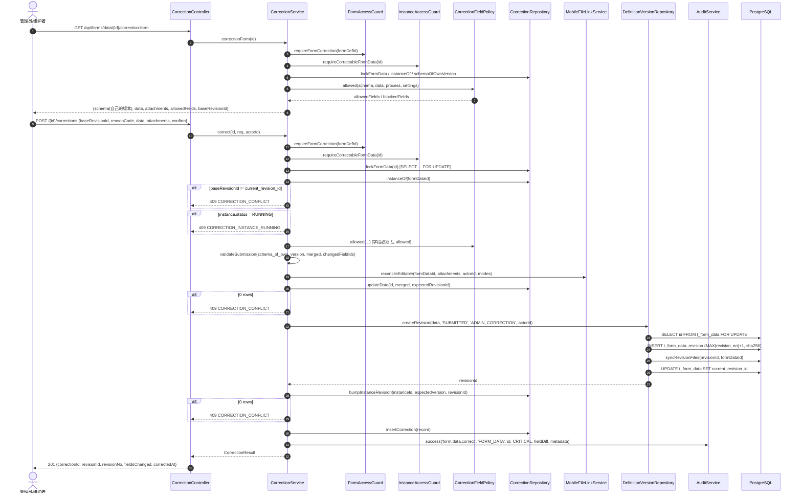
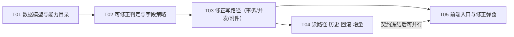

# 已提交表单数据的事后修正（Correction）— 设计与任务分解

> 状态：设计稿（待评审）｜作者：架构师｜版本：2026-10-23
> 适用范围：`backend/`（核心）、`frontend/`（台账入口）、`docs/`
> 本文只讲设计与任务拆分，不含实现代码；伪 SQL 与接口签名用于固定语义。

---

## 0. 结论摘要（先看这 10 行）

| 项 | 结论 |
| --- | --- |
| 推荐方案 | **A：原地修正**——改 `t_form_data.data` + **复用** `createRevision(..., reason='ADMIN_CORRECTION')` 追加修订，**不重走审批** |
| 新增能力码 | `form:data:correct`（只增不改，登记在 `PermissionCatalog`） |
| 谁能改 | 全局管理员（全部、含归属未确认）；表单维护者（`t_form_maintainer` **且** 持有能力，限**本公司**、归属已确认的数据） |
| 允许的单据状态 | 实例 `APPROVED / REJECTED / WITHDRAWN`，或无实例的 `SUBMITTED`；**`RUNNING` 一律拒绝**，`DRAFT` 不走此接口 |
| 不可改的东西 | `business_no / created_by / created_at / form_def_id / form_def_version / status / company_id / company_inferred`（结构性列，白名单之外） |
| schema 漂移 | 修正**永远在单据自己的 `form_def_version` 上做**，校验用该版本的 schema；**不用** `t_form_definition.schema`（最新版） |
| 实例影响 | 只改 `current_form_revision_id` + `version`（乐观锁）；**status / 节点 / 审批意见 / 抄送全部不动** |
| 并发 | `baseRevisionId` + `WHERE current_revision_id IS NOT DISTINCT FROM ?` 双保险 → `409 CORRECTION_CONFLICT` |
| 下游 | 报表/BI 视图读**实时主表**，天然一致；外部抽取靠新增的 `corrections?sinceId=` 增量接口补拉 |
| 新迁移 | `V72__form_data_correction.sql`（新表 `t_form_data_correction`，**不改任何既有表结构**） |

---

## 1. 代码现状核实（决定方案的三条事实）

团队给的事实我全部采信，另外补三条**会直接改变设计**的发现，都有代码位置：

| # | 发现 | 位置 | 为什么重要 |
| --- | --- | --- | --- |
| F1 | `createRevision` 取 version_id 用的是 **`data.getFormDefVersion()`**，不是表单最新版 | `DefinitionVersionRepository:153` | 说明"在旧版本上追加修订"是这个原语的**原生行为**，不需要新造轮子；也意味着修正不会把老单据偷偷升版 |
| F2 | `syncRevisionFiles` 是 `INSERT ... SELECT FROM t_form_data_file`，即**修订附件快照来自主表当前附件集** | `DefinitionVersionRepository:192` | 写序被钉死：**必须先 reconcile `t_form_data_file`，再 `createRevision`**，否则快照复制到的是旧附件 |
| F3 | 实例详情 / 附件校验 / 选项解析的 schema 都取 **`instance.current_form_revision_id`**，而表单**值**取 `t_form_data.data` | `MobileWorkflowMapper:276/327`、`MediaSubmissionValidator:40`、`OptionSchemaResolver:59`、`FormDataMapper:85` | 修正必须**同时**写主表与实例指针；只写一边会出现"字段按 A 版本渲染、值来自 B 内容"的错位 |
| F4 | `FormDataImportWriter` **只写 `t_form_data`，不产生修订** | `form/importer/FormDataImportWriter:97` | 存量里存在大量 `current_revision_id IS NULL` 的行 → 修正必须容忍 `baseRevisionId == null` |
| F5 | 业务单号可由**表单字段拼出**（`FIELD` 部件） | `BusinessNumberService:43` | "被单号规则引用的字段"必须进**黑名单**：改了它，单号与内容就自相矛盾，而单号不能变 |
| F6 | 条件分支引用字段的形状是 `props.groups[].conditions[].field` | `ConditionEvaluator:14-24` | 可以**静态抽取**出"参与流程走向判定"的字段集合 → 黑名单可实现 |

---

## 2. 方案对比

### 2.1 候选清单

| 方案 | 一句话 | 重走审批 | 数据真源 | 改动面 |
| --- | --- | --- | --- | --- |
| **A 原地修正 + 追加修订** | 改主表，并把这次改动记成一条新修订 | 否 | `t_form_data` | 中（复用现有 4 个原语） |
| B 独立"修正单"走审批 | 生成一张修正单，审批通过后再回写原单 | 是 | 两张表单 | 大 |
| C 复用 `NEEDS_REVISION` | 把实例打回、造 REWORK 任务，让原提交人改后重提 | 是 | `t_form_data` | 小（语义错） |
| D 只追加修订、读侧切到修订 | 不动主表，让所有读路径改读 `current_revision` | 否 | 修订表 | 大（要改造全部读路径） |

### 2.2 逐个评述

**A 原地修正 + 追加修订（推荐）**

- 工作机制：单事务内 `FOR UPDATE` 锁 `t_form_data` 行 → 校验并发基准 → 合并白名单字段并校验（**单据自己版本**的 schema）→ `reconcile` 附件 → 写主表 `data`（带 `current_revision_id` CAS）→ `createRevision(..., 'SUBMITTED', 'ADMIN_CORRECTION')` → 同步实例 `current_form_revision_id`/`version` → 写修正台账 → 写审计。
- 优点：① 用户要的语义就是它（"改对内容，不走审批"）；② **零新增数据通路**——台账、导出、实例详情、BI 视图、附件校验全部继续读原来的地方，不会出现"某处看不到修正"；③ 审计与历史靠已有修订机制天然成立；④ 与 `NODE_EDIT`/`RESUBMIT`/`REJECTED` 三种既有修订写在同一张表、同一套取号逻辑上，不会出现两套历史。
- 缺点：① 会**改写已生效的业务结论**（审批人说"同意 5000"，事后变成 3000），必须靠审计 + 可见标记 + 通知来补偿；② 主表是热点表，多了一次行锁写；③ 需要额外一张台账表记录"为什么改、改了哪些、能不能回滚"。
- 适用边界：审批已终态的单据，错在**数据**、不在**结论**。

**B 独立"修正单"走审批**

- 机制：新建一张"数据修正申请"单据，引用原单 id + 新旧值，审批通过后由系统回写原单（回写本身仍需要 A 的全部机制）。
- 优点：责任链完整，改敏感金额时有第二个人背书。
- 缺点：① 直接违背用户需求（明确"不重新走审批"）；② 需要新表单、新流程、新回写器，工期约 A 的 3 倍；③ 回写阶段仍需 A 的并发/schema 处理，复杂度不减。
- 适用边界：**高敏感金额**（如结算、发票）场景。可作为 A 之上的**可选复核策略**（见 §3.5），而不是替代品。

**C 复用 `NEEDS_REVISION` 语义**

- 机制：把 APPROVED 实例的状态改回"待修改"，生成 REWORK 任务给原提交人，走 `ReworkService` 的 `RESUBMIT` 路径。
- 优点：零新增写路径，全部复用。
- 缺点：① 语义错——`RESUBMIT` 的语义是"驳回后重提"，会把实例从终态**推回运行态**，已完成的审批留痕失真，甚至可能重新触发审批人解析；② 权限错——维护者会变成"替别人重提"，任务归属、待办、通知全都乱；③ `t_process_instance.status` 的 CHECK 里没有"待修改"，要动状态机。
- 结论：**排除**。

**D 只追加修订，读侧全局切到修订**

- 机制：`t_form_data.data` 不动，把所有读路径改成读 `current_revision_id` 的 `data`。
- 优点：主表不可变，最"干净"。
- 缺点：读路径有 **12+ 处**（台账 `selectPage`、导出、`selectSchemas`、实例详情、任务详情、移动端列表、`MediaSubmissionValidator`、`OptionSchemaResolver`、报表、BI 视图 SQL…），任何一处漏改就出现"两个页面两个值"；BI 视图（`v_form_ledger`）是 SQL 视图，改它要同步改 `infra/sql/readbi-post-process-ledger.sql` 并重跑。风险与收益完全不匹配。
- 结论：**排除**，但它提醒了一个不变量：**主表与修订必须同事务双写且内容一致**（见 §12 不变量 I2）。

### 2.3 推荐

> **选 A**，并叠加一个 `t_form_data_correction` **修正台账表**（只记录"事件的元信息"，不存数据副本——数据副本由修订表承担）。

理由三句话：
1. 它的写路径**全部是既有原语**（`createRevision` / `reconcile` / `validateSubmission` / `MediaSubmissionValidator`），新增代码集中在"判定 + 编排"，没有第二条数据通路，等于把出错面压到最小。
2. 它满足"不重走审批"的硬需求，同时把"历史可追溯"这件事交给已经存在的修订机制，审计表只管"谁在什么时候为什么改"。
3. 它的失败模式是**可解释的**：并发冲突 409、字段禁止 400、版本缺失 409，每一种都能在 UI 上说人话；B/C 的失败模式是"审批流程走歪了"，代价高一个量级。

---

## 3. 权限模型

### 3.1 新能力码

| 项 | 值 |
| --- | --- |
| code | `form:data:correct` |
| 名称（目录里必须中文） | `修正已提交数据` |
| 声明位置 | `PermissionCodes.FORM_DATA_CORRECT` + `PermissionCatalog` 新增一行 |
| Risk | `HIGH`（授予时的警示等级，与 `form:data:import` 同级） |
| adminOnly | `false`（维护者角色也要能授） |
| 数据范围 | **不声明**（`scopeable=false`）。写操作不消费 scope，声明了只会在角色页显示一个永远不生效的下拉——`FORM_DATA_IMPORT` 已有同样的先例与注释 |
| 操作审计等级 | **`CRITICAL`**（与能力等级刻意不同：能力等级服务于"授予时的警示"，审计等级服务于"事后排查时的排序"） |
| 废弃 | 不涉及；未来若语义变化，新增 `form:data:correct_v2`，**不复用**旧码 |

### 3.2 三层鉴权落点

| 层 | 落点 | 判定 |
| --- | --- | --- |
| ① 端点能力 | `@PreAuthorize("@authz.console('form:data:correct')")` + `authorizationService.requirePermission(...)`（两处都写，与 `FormDataController` 现有风格一致） | 有没有"修正"这个动作的授权 |
| ② 资源授权 | `FormAccessGuard.requireFormCorrection(formDefId)`：`admin → 放行`；否则 `requirePermission(correct)` **且** `hasFormMaintainer(formDefId, userId)` | 是不是**这张表单**的维护者（`t_form_maintainer` 成员关系 + 原子能力双满足，形状照抄 `requireFormMaintenance`） |
| ③ 数据范围 | `InstanceAccessGuard.canCorrectFormData(formDataId)`（新增）：`admin → true`；否则要求 `company_id` 非空 **且** `company_inferred = false` **且** `company_id = 本人公司`；**刻意不叠加** `form:data:read` 的 scope | 这条**单据**能不能动 |

**为什么第 ③ 层不叠加 `form:data:read` 的 scope（这是本次最关键的一次判断）**：
`form:data:read` 的默认范围是 `SELF`。若修正复用它，维护者就只能修正自己提交的单据——而"修别人填错的单"正是本功能存在的理由，等于功能不可用。公司边界已经收敛了横向风险，纵向风险由 `CRITICAL` 审计 + 修正台账 + 提交人通知来兜。这属于**刻意的例外**，必须在代码注释与单测里锁死，防止后人"顺手补上"。

对外语义仍沿用现有约定：**未授权返回"资源不存在"**（`HiddenResourceException`），不泄露单据存在性；**已授权但业务上不允许**才返回明确错误（400/409）。

### 3.3 管理员 vs 表单维护者

| 维度 | 全局管理员 | 表单维护者（持有 `form:data:correct`） |
| --- | --- | --- |
| 表单范围 | 任意表单 | 仅 `t_form_maintainer` 覆盖的表单 |
| 数据范围 | 全部（**含**归属未确认 / 跨公司） | 本公司内、**归属已确认**（`company_id` 非空且 `company_inferred=false`）的数据 |
| 允许的实例状态 | APPROVED / REJECTED / WITHDRAWN / 无实例 | 同（`RUNNING` 都禁止） |
| 换版修正（按最新 schema 重填） | 阶段二开放 | **不开放** |
| 一键回滚 | 可（任意历史修订） | 可（本公司内、且仅回滚"由本表单修正产生"的修订） |
| 结构性列（单号/归属/提交人/版本） | 禁止 | 禁止 |
| 归属未确认的数据 | 可修（但**不会**顺手把归属"确认"掉） | 不可修 → 提示"请联系管理员确认归属" |

### 3.4 字段白名单 / 黑名单（必须有，且必须是**服务端算的白名单**）

原则：**白名单由服务端生成并随接口下发，前端只渲染；请求里出现白名单之外的字段一律拒绝**。前端的任何"禁用"都只是提示，不是边界。

`allowedFields = （单据自己 form_def_version 的 schema 字段集） − 黑名单 − 附件以外不可编辑的结构性节点`

| 黑名单类别 | 判定来源（可静态抽取） | 为什么禁止 | UI 提示 |
| --- | --- | --- | --- |
| **参与流程走向判定** | 流程快照中所有 `props.groups[].conditions[].field` | 改了它，历史审批里"为什么走这条分支"就解释不通；要么改结论，要么改数据，不能只改数据 | "该字段决定审批走向，修正会与历史审批冲突，请走重开审批" |
| **参与业务单号生成** | `t_form_definition.settings.businessNumber.parts[].fieldId`（见 F5） | 单号不可变，改了字段会让单号与内容自相矛盾 | "该字段参与单号生成，单号已固定，不能修正" |
| **组织/公司维度映射源** | 表单 settings 的 org 映射；被 BI 台账用作部门/公司列的字段 | 会让单据在别人的可见范围里"凭空出现/消失"（§7） | 仅管理员可改 + 二次确认 |
| **结构性列**（非 schema 字段） | 接口参数白名单（服务端硬编码） | 单号、归属、提交人、版本是事实记录，不是内容 | 直接 400 |
| **抽取失败时的兜底** | 流程快照解析异常 | 无法证明"改它安全"就不许改（fail-closed） | "无法确认该字段是否影响审批，暂不可修正，请联系管理员" |

反向说明两条**不**进黑名单、但容易被误拦的：
- **ROOT 节点 `formPerms = HIDDEN` 的字段**：允许修正。发起人看不到 ≠ 管理员不能改错，HIDDEN 只约束发起入口。
- **已从新版 schema 移除、但存在于单据自己版本的字段**：允许修正。因为我们校验的是**该单据自己的版本**，"新版删了字段"与这张老单据无关。

### 3.5 二次确认

| 触发条件 | 服务端强制 | 前端表现 |
| --- | --- | --- |
| 任意修正 | `reasonCode` 必填（`AMOUNT_ERROR / TYPO / WRONG_ATTACHMENT / MISSING_VALUE / OTHER`）；`reasonCode = OTHER` 时 `reasonText` ≥ 10 字；`confirm = true` 必填 | 弹窗展示**字段级 before → after diff** + 一句红字："该单据已审批通过；修正**不会**重走审批，但会写入审计并通知提交人" |
| 修改 `money` / `number` 字段 | 同上 + `reasonText` 必填（不限 10 字） | 金额类改动单独高亮 |
| 修改"组织维度映射源"字段 | 仅管理员可提交 | 额外勾选"我了解该改动会影响报表分组与可见范围" |

**不做**的两件事（避免过度设计，写在这里是为了防止后人"顺手加"）：
- 不做"输入字段名以确认"这类体力活，它只增加出错率不增加安全性；
- 不在 MVP 做"双人复核"（方案 B 的轻量版）。未来若财务类表单需要，做成**表单级开关** `settings.correction.requiresReview`，而不是全局默认。

---

## 4. 数据一致性

### 4.1 写序（单事务，顺序不可调换）

```sql
BEGIN;
-- 1) 权威读取 + 锁行（并发基准从这里取，不是从请求里取）
SELECT id, form_def_id, form_def_version, data, status, business_no,
       current_revision_id, company_id, company_inferred, created_by
  FROM t_form_data WHERE id = :id FOR UPDATE;

-- 2) 找实例（可能没有：导入行 / 无流程提交）
SELECT id, status, version, current_form_revision_id
  FROM t_process_instance WHERE form_data_id = :id ORDER BY id DESC LIMIT 1;

-- 3) 并发基准比对（客户端带 baseRevisionId，null 表示"没有修订"）
--    不一致 → 409 CORRECTION_CONFLICT（有人先改过：NODE_EDIT / RESUBMIT / 另一次修正）

-- 4) 字段策略 + 校验：schema = t_form_definition_version(form_def_id, form_def_version)
--    allowed = CorrectionFieldPolicy(...);  请求字段 ⊆ allowed
--    formDefinitionService.validateSubmission(schema_of_that_version, merged, changedFieldIds)
--    附件字段按 modes = {changed: EDITABLE, 其余: READONLY} 交给 mediaValidator

-- 5) 附件先落主表集合（F2：修订快照从这里复制）
--    MobileFileLinkService.reconcileEditable(formDataId, attachments, actorId, modes)

-- 6) 主表写（第二条并发保险）
UPDATE t_form_data SET data = :merged, updated_at = now()
 WHERE id = :id
   AND current_revision_id IS NOT DISTINCT FROM :baseRevisionId;
-- 0 行 → 409 CORRECTION_CONFLICT

-- 7) 追加修订（复用原语；内部再锁行 + MAX+1 取号 + 同步附件快照 + 回写 current_revision_id）
--    DefinitionVersionRepository.createRevision(data, 'SUBMITTED', 'ADMIN_CORRECTION', actorId)

-- 8) 实例指针 + 乐观锁（不改 status / current_node_id / finished_at）
UPDATE t_process_instance
   SET current_form_revision_id = :revisionId, version = version + 1
 WHERE id = :instanceId AND version = :instanceVersion;
-- 0 行 → 409 CORRECTION_CONFLICT

-- 9) 修正台账
INSERT INTO t_form_data_correction(...);

-- 10) 审计（append-only，与业务同事务；见 §6）
COMMIT;
```

三条写序的"为什么"：

| 约束 | 违反后的现象 |
| --- | --- |
| 附件必须在 `createRevision` **之前** reconcile | 修订快照复制到旧附件集 → 历史版本展示的附件与当时的 data 不匹配，且无法自愈 |
| `createRevision` 必须在主表 `UPDATE data` **之后** | 修订的 checksum 与主表内容不一致 → §12 不变量 I2 破 |
| 实例指针必须与主表**同事务** | 实例详情按新修订取 schema、按主表取值 → 版本错位（F3） |

### 4.2 附件（`t_form_data_file` vs `t_form_data_revision_file`）

| 表 | 角色 | 修正时 |
| --- | --- | --- |
| `t_form_data_file` | **当前**附件集合（受理、导出、详情展示都以它为主） | 用既有 `MobileFileLinkService.reconcileEditable` **增量替换**：只动被允许的字段，其它字段的附件原样保留 |
| `t_form_data_revision_file` | 每个修订的附件**快照**（不可变） | **不手写**，由 `syncRevisionFiles` 从当前集合复制（F2）。修正后自动得到新快照 |

- 附件字段的值同时存在于 `data`（字段值里是 file 引用数组）与 `t_form_data_file`（关系表）——**两处必须同时改**，由 `reconcileEditable` + `merged data` 一次事务内保证。
- 删除的附件只是**解绑关系**，`t_mobile_file` 行与对象存储里的文件不动（审计与追溯需要）。
- 审计里附件只记 `fileId` 增删，**不记 URL、不记内容**（审计表长期保留且可导出，`fileId` 已经足够定位）。

### 4.3 `form_def_version` 漂移（最容易出事的地方）

先把事实钉住：
- `t_form_data.form_def_version` = 这张单据**填报时**的表单版本，是个快照，**修正不改变它**。
- `t_form_definition_version(form_def_id, version_no)` 是**不可变**的历史 schema（V31 建立；`legacy_approximate = true` 的行表示"旧 schema 未知，用当时最新 schema 近似"）。
- `createRevision` 用 `formVersionId(formDefId, formDefVersion)` 定位版本行 → 修正产出的修订**自动钉在旧版本上**（F1）。

设计规则：

| 场景 | 处理 |
| --- | --- |
| 单据版本 < 表单最新版（常态） | **在旧版本上修正**。校验/渲染都用 `t_form_definition_version(form_def_id, form_def_version).schema`。**禁止**用 `t_form_definition.schema`（最新） |
| 新版本**删除**了某字段 | 旧 schema 里仍有该字段 → 允许看、允许改（它属于这张单据的事实）。不做"顺手清理孤儿字段" |
| 新版本**新增**了必填字段 | **不强制补填**。校验集合 = 被修改的字段（`validateSubmission(schema, merged, changedFieldIds)` 的既有语义），不是全量必填校验。否则老单据永远修不了 |
| 版本行缺失（`VERSION_NOT_FOUND`） | 返回 `409 CORRECTION_SCHEMA_UNAVAILABLE`，并提示"该单据的版本快照缺失，需管理员走按最新版本重填" → **阶段二**能力，MVP 只报错不动手 |
| `legacy_approximate = true` | 允许修正，但 `correction-form` 响应带 `schemaApproximate: true`，前端提示"该单据的原始表单版本为近似还原，字段可能与当时略有差异" |
| 字段 id 在新旧版本间复用但类型变了 | 因为只在旧版本上操作，类型永远取旧版本定义 → 不会出现"按新类型校验旧值"的错乱 |

> **一条硬不变量**：修正的**渲染 schema** 与**校验 schema** 必须是同一份文本（同一条 SQL 取值口径）。历史上"台账用 A 版本渲染、提交用 B 版本校验"已经害过一次（`FormDataMapper.selectSchemas` 的注释就是在说这件事），这里必须显式引用同一处取值。

---

## 5. 实例状态是否变更

| 字段 | 变？ | 理由 |
| --- | --- | --- |
| `status` | **不变** | 审批结论是"这批人对当时的内容做了决定"；修正不重新决策，所以结论标记保留原值 `APPROVED` |
| `current_node_id` | 不变 | APPROVED 时已是终态；改它会破坏监控与流程图 |
| `finished_at` | 不变 | 完成时间不因数据更正而改变 |
| `started_by / started_at` | 不变 | 事实记录 |
| `version` | **+1** | `@Version` 乐观锁，必须自增，让并发写者看到"实例被碰过" |
| `current_form_revision_id` | **改** | 指向新修订。这是**唯一**被修正改写的实例列（F3） |
| `t_task` / `t_cc_record` / `t_approval_comment` | **完全不动** | 审批留痕是历史事实，修正不得增删改 |

**为什么允许 `REJECTED` / `WITHDRAWN` 也修正**：驳回但未重提的单据，"金额填错"同样要改对；撤回的单据也是已发生事实。两者修正后**不会**自动变 `APPROVED`——修正与结论无关。

**与审批中 `NODE_EDIT` 回写的冲突**：`NODE_EDIT` 只发生在 `RUNNING`（`FieldEditApplier:104` 的 `v2.active(pi)` 分支）。修正**拒绝 `RUNNING`**，所以两者在时间上互斥，不存在同一实例上并发写 `t_form_data` 的路径：

- `RUNNING` 的单据要改字段 → 走审批节点的字段权限（`formPerms = EDITABLE`）或撤回后重提，接口直接回 `409 CORRECTION_INSTANCE_RUNNING` 并在消息里给出这两条出路。
- 唯一残留的竞争是 `REJECTED + 待重提` 与修正并发：两者都通过 `createRevision` 追加修订，靠 `baseRevisionId` CAS + 行锁串行化，**后到者拿 409**，不会产生两条同号修订（`createRevision` 的 `FOR UPDATE` 已经解决了取号竞态）。

**`t_process_instance.version` 怎么用**：请求里不带 version（客户端不该猜），服务端在读实例时取，写时 `WHERE version = :read`，0 行 → 409。理由：修正是低频人工操作，冲突时"重读一遍再点一次"成本极低，比引入 `If-Match` 头更简单。

---

## 6. 审计与回滚

### 6.1 审计事件

| 字段 | 值 |
| --- | --- |
| `action` | `form.data.correct` / `form.data.correct.rollback` |
| `resource_type` / `resource_id` | `FORM_DATA` / `form_data_id` |
| `risk_level` | `CRITICAL` |
| `field_diff` | `{ "<fieldId>": {"from": <旧值>, "to": <新值>} }`；附件字段为 `{ "<fieldId>": {"filesRemoved": [id...], "filesAdded": [id...]} }`。长文本（>256 字）只记 `{lengthFrom, lengthTo}`，不落原文 |
| `metadata` | `formDefId, formDefVersion, businessNo, instanceId, instanceStatus, schemaApproximate, reasonCode, reasonText, baseRevisionId, newRevisionId, revisionNo, correctionId, companyId, fieldsChanged[], attachmentsChanged, rollbackOf` |
| 失败/拒绝 | `authorizationService`/门禁抛异常前记 `denied`（`DENIED`，含 failureCode：`CORRECTION_CONFLICT` / `CORRECTION_INSTANCE_RUNNING` / `CORRECTION_FIELD_FORBIDDEN`），保证"尝试修正"本身可查 |

`t_audit_event` 是 **append-only**：本设计**不**修改任何历史事件；回滚也不删旧事件，只追一条新的。

### 6.2 回滚

- **语义**：回滚 = "用某历史修订的内容**再修一次**"，产生一条新修订，`reason = 'CORRECTION_ROLLBACK'`，并在台账里 `rollback_of` 指向被回滚的修正 id。
- **绝不**删除 `t_form_data_revision` / `t_form_data_revision_file` 行，绝不改它们的内容（有外键 + 审计要求）。
- 目标选择：默认"回到上一次修正之前"（`from_revision_id`）；也支持指定任意历史修订（管理员）。
- 冲突：若目标字段在之后又被别人改过 → `409`，提示"该字段已被后续修正改动，请确认后再回滚"（不静默覆盖）。
- MVP 提供 `POST /{id}/corrections/{correctionId}/rollback` 一条路径（回滚到该修正之前的版本）；"任选历史版本回滚"是阶段二。

---

## 7. 公司归属与可见性（重点坑）

先把机制说清楚，结论才站得住：

1. **单据的公司归属是创建时快照**（`t_form_data.company_id` + `company_inferred`），由 `CompanyAttribution` 按发起人**当时的部门**解析；`CompanyAttribution.forDraft` 的注释明确禁止"按今天部门重算"。**表单内容里的字段值从来不是归属来源。**
2. 所以：**修正任何表单字段都不会改变 `company_id`，因而不会改变可见性**。这是本设计最重要的一句结论——它把"公司门槛"这个大坑从"必须处理"降级为"必须防住别人打开它"。
3. 但 `FormAccessGuard.hasFormGrant` 的门槛（主体匹配 + `EXISTS(company_grant)`）仍然是**读入口的门槛**，修正入口必须复用同一把尺子，否则会造出"不可见但可改"的通道。

据此定下三条规则：

| 规则 | 内容 | 理由 |
| --- | --- | --- |
| R1 | 修正**永不写** `company_id` / `company_inferred`（结构性列，参数白名单之外，服务端硬拒） | 一旦能改归属，单据会从某些人的台账里消失或凭空出现，且没有任何历史能解释 |
| R2 | 归属**未确认**（`company_id IS NULL` 或 `company_inferred = true`）的数据 → 只有全局管理员可修正；修正**不**顺手把 `company_inferred` 改成 `false` | 不允许用一次内容订正把"不确定的归属"洗成"事实" |
| R3 | 修改"组织/公司维度映射源"字段（§3.4）→ 仅管理员 + 二次确认 + 审计 metadata 标 `visibilityImpact: "downstream-only"` | 它不影响归属列，但会影响 BI 台账的部门分组，属于下游可见性变化，要留痕 |

**若将来业务真的需要"把单据从 A 公司挪到 B 公司"**：那是**另一个动作**（建议 `form:data:attribution:fix`），不是修正的隐藏参数。它必须走：管理员 → 双人复核 → 显式审计 `CRITICAL` → 同步 `t_process_instance.company_id` → 重算"提交人是否仍有该表单使用授权（`hasFormGrant`）"→ 通知双方公司管理员 → 下游刷新。这一条写进文档是为了**堵住"顺手加个参数"的诱惑**，本次不实现。

---

## 8. 下游一致性（报表 / BI / 台账）

| 下游 | 读什么 | 修正后是否一致 | 措施 |
| --- | --- | --- | --- |
| 后台台账列表 / 导出（`FormDataService.adminPage/exportRows`） | `t_form_data` 主表 | ✅ 立即一致 | 无需动作 |
| 报表中心（`ReportService` / `FormDataExport`） | 主表 + `selectSchemas` | ✅ 立即一致 | 无需动作 |
| BI 视图 `v_form_ledger` / `v_form_field_catalog` / `v_form_catalog` / `v_form_ledger_checklist` | **实时视图**（非物化） | ✅ 立即一致 | 需在文档里写明"这些视图是实时视图，当前没有 MV；若将来引入 MV，修正必须触发刷新" |
| readbi 单表单视图（`infra/sql/readbi-post-process-ledger.sql`） | 同上，实时 | ✅ 立即一致，**不需要重跑脚本**（脚本只在表单 code 变化时重跑） | 无需动作 |
| 外部 BI / 数据仓库（已抽取走的数据） | 各自仓库 | ❌ 会过期 | 见下 |

外部抽取的应对——**给增量不推值**：

```
GET /api/forms/data/corrections?sinceId=<lastSeen>&limit=500
→ { items: [{ id, formDataId, formDefId, businessNo, revisionNo, fieldsChanged[], correctedAt }], nextSinceId }
```

- 下游按 `id` 增量拉取，拿到 `formDataId` 后**用自己的同步任务重取该单据**（走它本来就在用的读取接口/视图）。
- **刻意不在这个接口里返回值**：否则它就成了绕过数据范围的读取通道。这个接口只需要 `form:data:read`，且只回 id 与元信息。
- MVP 不做"主动推送/回调"：`outbox` 里已经有一套消息机制，等真有外部消费方接入时再挂，避免现在过早耦合。

**另外两件"不该被修正破坏"的事**：
- `business_no` 不变（唯一索引 `uk_form_data_business_no` 也不受影响）。
- 导入防重键（`V67__form_data_import_key.sql`）落在 `t_form_data` 上，修正不改它 → 重复导入的判断不会被修正打乱。

---

## 9. 接口契约

### 9.1 端点

| # | 方法 | 路径 | 用途 | 能力 |
| --- | --- | --- | --- | --- |
| 1 | `GET` | `/api/forms/data/{id}/correction-form` | 取"可修正视图"：schema（**单据自己版本**）、当前值、附件、**allowedFields**、blockedFields（含原因）、实例状态、`baseRevisionId`、`schemaApproximate` | `form:data:correct` |
| 2 | `POST` | `/api/forms/data/{id}/corrections` | 提交一次修正 | `form:data:correct` |
| 3 | `GET` | `/api/forms/data/{id}/corrections` | 修正历史（分页） | `form:data:correct` |
| 4 | `POST` | `/api/forms/data/{id}/corrections/{correctionId}/rollback` | 回滚到该修正之前的修订（产生新修正） | `form:data:correct` |
| 5 | `GET` | `/api/forms/data/corrections?sinceId=&limit=` | 下游增量拉取（只回 id 与元信息） | `form:data:read` |

> 用 **POST + 子资源**而不是 `PUT /{id}`：修正不是幂等替换，它是"产生一次带原因的变更事件"，重复提交必须得到两条记录（或一条冲突），不能被吞成覆盖。

### 9.2 请求 / 响应

```jsonc
// 1) GET /{id}/correction-form
{
  "dataId": 1024,
  "formDefId": 44,
  "formDefVersion": 3,               // 单据自己的版本，不是最新
  "schemaApproximate": false,
  "baseRevisionId": 8812,            // null = 该单据还没有修订（导入行）
  "instanceId": 9931,                // null = 无流程单据
  "instanceStatus": "APPROVED",      // null = 无实例
  "data": { "f_amount": 5000, "f_remark": "……" },
  "attachments": [{ "fileId": "…", "fieldId": "f_invoice", "sortOrder": 0 }],
  "allowedFields": ["f_amount", "f_remark", "f_invoice"],
  "blockedFields": [
    { "fieldId": "f_dept", "reason": "DECIDES_FLOW", "message": "该字段决定审批走向…" }
  ],
  "fieldModes": { "f_amount": "EDITABLE", "f_dept": "READONLY" }
}

// 2) POST /{id}/corrections
{
  "baseRevisionId": 8812,            // 必填（可为 null，但要显式传）
  "reasonCode": "AMOUNT_ERROR",
  "reasonText": "8 月报销金额录成 50000，应为 5000，附财务确认邮件",
  "confirm": true,
  "data": { "f_amount": 5000 },       // 只提交改动的字段
  "attachments": [ ... ]              // 可选：被修字段的完整附件集（reconcile 语义）
}

// 201 Created
{
  "correctionId": 77,
  "revisionId": 8813,
  "revisionNo": 4,
  "dataId": 1024,
  "businessNo": "BX2026080012",
  "instanceId": 9931,
  "fieldsChanged": ["f_amount"],
  "attachmentsChanged": false,
  "correctedAt": "2026-10-23T09:12:31Z"
}
```

### 9.3 错误码

| 错误码 | HTTP | 含义 | 用户看到的话 |
| --- | --- | --- | --- |
| （`HiddenResourceException`） | 404 | 无权限 / 单据不存在 / 不是该表单维护者 | "表单数据不存在"（沿用现有不泄露口径） |
| `CORRECTION_CONFLICT` | 409 | `baseRevisionId` 与当前修订不一致，或主表/实例 CAS 落空 | "这条数据刚刚被改动过，请重新打开后再修正" |
| `CORRECTION_INSTANCE_RUNNING` | 409 | 实例仍在审批中 | "审批中的单据不能这样修正：请用审批节点的字段权限，或先撤回" |
| `CORRECTION_STATUS_NOT_ALLOWED` | 400 | `DRAFT`，或实例状态不在允许集合 | "草稿请直接修改；此状态不支持修正" |
| `CORRECTION_SCHEMA_UNAVAILABLE` | 409 | 该 `(form_def_id, form_def_version)` 版本行缺失 | "该单据的表单版本快照缺失，请联系管理员" |
| `CORRECTION_FIELD_FORBIDDEN` | 400 | 请求字段不在 `allowedFields`（含黑名单） | 指名到字段："字段「所属部门」不允许事后修正：它决定审批走向" |
| `CORRECTION_FIELD_UNKNOWN` | 400 | 字段 id 不在该单据版本的 schema 里 | "字段不存在于这张单据的表单版本" |
| `CORRECTION_REASON_REQUIRED` | 400 | 缺 `reasonCode` / `OTHER` 缺说明 / 缺 `confirm` | "请填写修正原因并确认" |
| `CORRECTION_COMPANY_UNCONFIRMED` | 409 | 归属未确认且操作者非管理员（R2） | "该单据的公司归属尚未确认，请联系管理员" |
| `FORM_DATA_INVALID` | 400 | 走既有 `validateSubmission` 抛出的字段级校验错误 | 原样透出字段错误（与提交表单口径一致） |

---

## 10. 数据模型

### 10.1 `V72__form_data_correction.sql`（伪 SQL，**不改任何既有表**）

```sql
-- 修正台账：一次修正一行。数据副本不在这里（在 t_form_data_revision），
-- 这里只回答"谁、何时、为什么、改了哪些字段、能不能回滚"。
CREATE TABLE t_form_data_correction (
    id                  BIGSERIAL PRIMARY KEY,
    form_data_id        BIGINT NOT NULL REFERENCES t_form_data(id),
    revision_id         BIGINT NOT NULL REFERENCES t_form_data_revision(id),
    from_revision_id    BIGINT REFERENCES t_form_data_revision(id),  -- 修正前那一刻（可为 NULL）
    instance_id         BIGINT REFERENCES t_process_instance(id),     -- 无实例单据为 NULL
    actor_user_id       BIGINT NOT NULL REFERENCES t_user(id),
    reason_code         VARCHAR(32) NOT NULL,
    reason_text         VARCHAR(500),
    field_changes       JSONB NOT NULL DEFAULT '{}'::jsonb,           -- {fieldId:{before,after}}
    attachments_changed BOOLEAN NOT NULL DEFAULT false,
    company_id_at_time  BIGINT REFERENCES t_company(id),              -- 留证据，不是改它
    instance_status     VARCHAR(16),                                  -- 留证据
    rollback_of         BIGINT REFERENCES t_form_data_correction(id),
    created_at          TIMESTAMPTZ NOT NULL DEFAULT now(),
    CONSTRAINT ck_correction_reason CHECK (reason_code IN (
        'AMOUNT_ERROR', 'TYPO', 'WRONG_ATTACHMENT', 'MISSING_VALUE', 'OTHER'))
);
CREATE INDEX ix_correction_data  ON t_form_data_correction(form_data_id, id DESC);
CREATE INDEX ix_correction_actor ON t_form_data_correction(actor_user_id, created_at DESC);
-- 下游增量拉取走主键顺序，BIGSERIAL 已足够，无需额外索引。
```

两点说明：
- **不改 `t_form_data`**（不加 `corrected_at` / `correction_count` 冗余列）。"是否被修正过"用 `EXISTS(SELECT 1 FROM t_form_data_correction WHERE form_data_id=?)` 派生。理由是避免"冗余列与台账不一致"这个新的不变量。
- `reason` 枚举进 `CHECK` 与 `ck_form_revision_status` 的既有风格一致：新增原因要新迁移，这是**刻意的摩擦**（原因集合是审计口径，不该随手膨胀）。

### 10.2 类图

```mermaid
classDiagram
    class FormDataCorrectionController {
        +correctionForm(id) CorrectionFormView
        +correct(id, CorrectionRequest) CorrectionResult
        +history(id, page, size) Page~CorrectionRecord~
        +rollback(id, correctionId) CorrectionResult
        +correctionsSince(sinceId, limit) CorrectionFeed
    }

    class FormDataCorrectionService {
        -FormDataCorrectionRepository repository
        -CorrectionFieldPolicy fieldPolicy
        -DefinitionVersionRepository versions
        -FormDefinitionService forms
        -MobileFileLinkService fileLinks
        -MediaSubmissionValidator media
        -AuditService audit
        +correctionForm(long id) CorrectionFormView
        +correct(long id, CorrectionRequest req, long actorId) CorrectionResult
        +rollback(long id, long correctionId, long actorId) CorrectionResult
        -requireCorrectable(FormData row, ProcessInstance inst)
        -merge(FormData row, Map edits, Set allowed) String
    }

    class FormDataCorrectionRepository {
        +lockFormData(long id) FormData
        +instanceOf(long formDataId) ProcessInstance
        +bumpInstanceRevision(long instanceId, int expectedVersion, long revisionId) int
        +insertCorrection(CorrectionRecord row) long
        +history(long formDataId, long offset, long limit) List~CorrectionRecord~
        +feed(long sinceId, int limit) List~CorrectionFeedItem~
        +revisionOwner(long revisionId) Long
    }

    class CorrectionFieldPolicy {
        +allowed(String schemaJson, String dataJson, String processJson, String settingsJson) Set~String~
        +blocked(String schemaJson, String dataJson, String processJson, String settingsJson) List~BlockedField~
        -flowReferencedFields(String processJson) Set~String~
        -businessNoFields(String settingsJson) Set~String~
    }

    class DefinitionVersionRepository {
        +createRevision(FormData data, String status, String reason, long actorId) long
        +formVersionId(long formDefId, int versionNo) long
        +revisionData(long revisionId) String
        +syncRevisionFiles(long revisionId, long formDataId) void
    }

    class FormAccessGuard {
        +requireFormCorrection(long formId) void
        +hasFormMaintainer(long formId, long userId) boolean
    }

    class InstanceAccessGuard {
        +canCorrectFormData(long formDataId, long userId) boolean
        +requireCorrectableFormData(long formDataId) void
    }

    class MobileFileLinkService {
        +reconcileEditable(long formDataId, List refs, long userId, Map modes) void
    }

    class MediaSubmissionValidator {
        +validate(long dataId, Map~String,String~ modes) void
    }

    class AuditService {
        +success(action, resourceType, resourceId, risk, fieldDiff, metadata) void
        +failure(action, resourceType, resourceId, risk, code, metadata) void
    }

    class FormData {
        +Long id
        +Long formDefId
        +Integer formDefVersion
        +String businessNo
        +String data
        +String status
        +Long currentRevisionId
        +Long companyId
        +Boolean companyInferred
    }

    class FormDataCorrection {
        +Long id
        +Long formDataId
        +Long revisionId
        +Long fromRevisionId
        +Long instanceId
        +Long actorUserId
        +String reasonCode
        +String reasonText
        +String fieldChanges
        +Boolean attachmentsChanged
        +Long rollbackOf
    }

    FormDataCorrectionController --> FormDataCorrectionService
    FormDataCorrectionService --> FormDataCorrectionRepository
    FormDataCorrectionService --> CorrectionFieldPolicy
    FormDataCorrectionService --> DefinitionVersionRepository
    FormDataCorrectionService --> MobileFileLinkService
    FormDataCorrectionService --> MediaSubmissionValidator
    FormDataCorrectionService --> AuditService
    FormDataCorrectionService --> FormAccessGuard
    FormDataCorrectionService --> InstanceAccessGuard
    FormDataCorrectionRepository --> FormData
    FormDataCorrectionRepository --> FormDataCorrection
    DefinitionVersionRepository ..> FormData : "createRevision 复用"
```



### 10.3 时序图（一次修正的完整调用）



---

## 11. 文件级改动清单

### 11.1 后端（新增）

| 文件 | 作用 |
| --- | --- |
| `backend/src/main/resources/db/migration/V72__form_data_correction.sql` | 新表 + 索引 + reason CHECK |
| `backend/src/main/java/com/antflow/form/correction/FormDataCorrectionController.java` | 5 个端点，端点能力注解 |
| `backend/src/main/java/com/antflow/form/correction/FormDataCorrectionService.java` | 事务编排、并发、审计（业务包，不依赖 `mobile`，符合 ArchUnit `domainDoesNotDependOnTheMobileAdapter`） |
| `backend/src/main/java/com/antflow/form/correction/FormDataCorrectionRepository.java` | 新表读写 + 行锁 + 实例指针 CAS + 增量查询 |
| `backend/src/main/java/com/antflow/form/correction/CorrectionFieldPolicy.java` | 白名单/黑名单计算（静态抽取条件字段、单号字段） |
| `backend/src/main/java/com/antflow/form/correction/CorrectionDtos.java` | 请求/响应 record（含错误码常量） |
| `backend/src/test/java/com/antflow/form/correction/…` | 单测（策略）+ 集成测试（并发/附件/schema 漂移/权限矩阵） |

### 11.2 后端（修改）

| 文件 | 改动 |
| --- | --- |
| `backend/src/main/java/com/antflow/authz/PermissionCodes.java` | 新增 `FORM_DATA_CORRECT = "form:data:correct"` |
| `backend/src/main/java/com/antflow/authz/PermissionCatalog.java` | 登记一行（`Risk.HIGH`，不声明 scope，名称中文） |
| `backend/src/main/java/com/antflow/authz/FormAccessGuard.java` | 新增 `requireFormCorrection(long formId)`（admin 短路 + 能力 + 维护人） |
| `backend/src/main/java/com/antflow/authz/InstanceAccessGuard.java` | 新增 `canCorrectFormData / requireCorrectableFormData`（R2 的归属判定在此） |
| `backend/src/main/java/com/antflow/authz/AuthorizationService.java` | 门面转发上述两个方法（保持 `FormGrantService` 等既有调用风格） |
| `backend/src/main/java/com/antflow/process/RevisionReasons.java`（新增） | 集中 5 个 reason 常量（`INITIAL_SUBMIT / NODE_EDIT / RESUBMIT / REJECTED / ADMIN_CORRECTION / CORRECTION_ROLLBACK`），把散落 4 处的字面量收口；**不改 `createRevision` 签名** |
| `backend/src/test/java/com/antflow/openapi/ApiContractSnapshotTest` 使用的 `frontend/config/antflow-api.json` | 用 `-Dantflow.openapi.write=true` 重新生成（新增端点必然触发契约门禁） |

**明确不改**：`FormDataController`（新增能力走独立 controller，避免 135 行的类继续膨胀）、`FormDataService`（338 行，不再加方法）、`DefinitionVersionRepository.createRevision`（语义正好够用，不加重载）、`t_form_data` / `t_form_data_revision` 表结构。

### 11.3 前端

| 文件 | 改动 |
| --- | --- |
| `frontend/src/pages/admin/FormData/CorrectionModal.tsx`（新增） | 按**单据自己版本**的 schema 渲染；只放开 `allowedFields`；diff 预览 + 原因 + 二次确认 |
| `frontend/src/pages/admin/FormData/CorrectionHistory.tsx`（新增） | 修正历史（阶段二可用；MVP 可先只读展示） |
| `frontend/src/pages/admin/FormData/useCorrection.ts`（新增） | 请求与状态（含 409 的"重新打开"引导） |
| `frontend/src/pages/admin/FormData/index.tsx` | 详情 Drawer 里加"修正数据"按钮（`hasCapability(user, CAPABILITY.formDataCorrect)` 控制可见，**仅 UI 提示**） |
| `frontend/src/authz.ts` | `CAPABILITY` 新增 `formDataCorrect: 'form:data:correct'` |
| `shared/api.generated.d.ts` | 由 `frontend/config/antflow-api.json` 重新 codegen |
| `frontend/config/page-capabilities.json` | 台账页若新增独立路由，则补一行；沿用现有页面则**不动**（按钮级权限在 `authz.ts`） |

**菜单/权限**：不需要新菜单（入口在既有"提交数据"台账详情里）；新能力点由 `PermissionCatalogSynchronizer` 启动同步进 `t_permission`，角色页自动出现，**无需 Flyway 插权限行**（`V40` 的注释已定此约定）。移动端本次不做。

---

## 12. 实施顺序（5 个任务）



| ID | 任务 | 主要文件 | 依赖 | 优先级 |
| --- | --- | --- | --- | --- |
| **T01** | 平台底座：V72 迁移 + 能力码登记 + `RevisionReasons` 收口 + 契约快照重建 | `V72__form_data_correction.sql`、`PermissionCodes`、`PermissionCatalog`、`RevisionReasons`、`frontend/config/antflow-api.json` | — | P0 |
| **T02** | 可修正判定：`requireFormCorrection` / `canCorrectFormData` / `CorrectionFieldPolicy`（条件字段、单号字段、结构性列）+ 权限矩阵与策略单测 | `FormAccessGuard`、`InstanceAccessGuard`、`AuthorizationService`、`CorrectionFieldPolicy` | T01 | P0 |
| **T03** | 修正写路径：controller + service + repository，事务写序、`baseRevisionId` CAS、实例乐观锁、附件 reconcile、`ADMIN_CORRECTION` 修订、审计 | `FormDataCorrectionController/Service/Repository`、`CorrectionDtos`、集成测试 | T02 | P0 |
| **T04** | 读路径与回滚：`correction-form` 视图（含 allowedFields/blockedFields）、修正历史、一键回滚、`corrections?sinceId=` 增量 | 上述 + `CorrectionHistory` 相关 DTO/查询 | T03 | P1 |
| **T05** | 前端：台账详情"修正数据"入口 + 修正弹窗（diff/原因/二次确认）+ 409 引导 + 契约类型 + 前端测试 | `CorrectionModal.tsx`、`useCorrection.ts`、`index.tsx`、`authz.ts`、`shared/api.generated.d.ts` | T03（接口签名冻结后即可开工，与 T04 并行） | P0 |

**MVP（可上线的最小范围）** = T01 + T02 + T03 + T05 的"入口 + 弹窗 + 保存路径"，其中：
- 必须包含：能力码、三层鉴权、字段白名单、单据自己版本的 schema 校验、附件 reconcile、实例指针同步、审计、409 并发语义。
- 可以推迟：T04 的修正历史 UI、一键回滚、下游增量接口、按最新版本重填（阶段二）、双人复核、提交人通知。

---

## 13. 风险与不变量

### 13.1 必须守住的不变量

| # | 不变量 | 校验手段 |
| --- | --- | --- |
| I1 | `t_form_data_revision` / `t_form_data_revision_file` **只增不改不删** | 代码只走 `createRevision` / `syncRevisionFiles`；集成测试断言修订行数单调增、旧行内容不变 |
| I2 | `t_form_data.data` 与 `current_revision_id` 指向的修订**内容一致**（校验和相等） | 写序固定（§4.1）；集成测试比对 `sha256(data)` 与修订 `checksum` |
| I3 | `business_no / created_by / created_at / form_def_id / form_def_version / status / company_id / company_inferred` 修正不可变 | 请求 DTO 里根本没有这些字段 + 服务端白名单断言；测试逐列比对修正前后 |
| I4 | 实例的 `status / current_node_id / finished_at / 审批任务 / 意见 / 抄送` 修正不可变，只允许 `current_form_revision_id`、`version` 变 | 集成测试比对 `t_task`、`t_cc_record` 行数与内容 |
| I5 | `RUNNING` 实例一律拒绝修正 | 状态判定 + 用例 |
| I6 | 渲染 schema 与校验 schema 是**同一份**（单据自己的 `form_def_version`） | 两者走同一条 SQL（单测断言调用的是同一个取值方法） |
| I7 | 归属未确认（`company_id IS NULL` 或 `company_inferred`）→ 仅管理员；修正不改归属标记 | `canCorrectFormData` 单测 + R1/R2 断言 |
| I8 | 审计 append-only | 不改 `t_audit_event` 与保护函数；只 `INSERT` |
| I9 | 修正请求字段 ⊆ `allowedFields`（服务端算） | 白名单校验在 service，不依赖前端 |
| I10 | 台账/导出/BI 视图继续读主表；**若将来引入物化视图，修正必须触发刷新** | 文档约束 + 视图定义注释 |

### 13.2 最容易踩的 8 个坑

| # | 坑 | 后果 | 防法 |
| --- | --- | --- | --- |
| 1 | **只追加修订、不改主表** | 台账/导出/实例详情（读主表）看不到修正，选项/附件校验（读修订）却跟着变 → "同一单据两个值" | I2 + 集测比对两处内容 |
| 2 | **先 `createRevision` 再 reconcile 附件** | 修订快照复制到旧附件（F2），历史版本永远错，且无法自愈 | 写序固定；集测断言修订快照 = 当前集合 |
| 3 | **忘了同步 `t_process_instance.current_form_revision_id`** | 详情按旧修订取 schema、按新主表取值（F3），字段错位；附件校验口径也不一致 | 写序第 8 步；集测断言指针已更新 |
| 4 | **用 `t_form_definition.schema`（最新）渲染或校验** | 老单据被新版的必填/类型挡住，或字段 id 错位导致丢值 | I6；代码里显式只从 `t_form_definition_version` 取 |
| 5 | **并发：只靠 `MAX(revision_no)+1` 的行锁** | 行锁只保证修订号不撞，**不保证**"基于最新内容合并"；两人各改一半会互相覆盖 | `baseRevisionId` CAS + `WHERE current_revision_id IS NOT DISTINCT FROM ?` 双保险 |
| 6 | **让"公司归属"跟着字段走**（给修正开个 `companyId` 参数，或修改后重算归属） | 单据从某些人的台账里凭空消失/出现，且无历史可解释 | R1/R2；参数白名单；归属变更走独立受控动作 |
| 7 | **修正"参与流程分支判定"的字段** | 历史审批的"为什么走这条分支"解释不通，审计上说不清责任 | 黑名单（`props.groups[].conditions[].field`）+ 抽取失败 fail-closed |
| 8 | **修正"参与单号生成"的字段** | 单号与内容自相矛盾，而单号有唯一索引不能改 | 黑名单（`settings.businessNumber.parts[].fieldId`）+ UI 明示原因 |

### 13.3 已知的不完美（接受并记录）

| 项 | 说明 |
| --- | --- |
| 审批结论与数据可能"不一致" | 审批人当时同意的是 5000，事后数据是 3000。这是本功能的**固有代价**，靠审计 + 台账 + UI 上的"已修正"标记 + 通知来补偿，不试图用技术手段消除 |
| `legacy_approximate` 版本行的 schema 是近似值 | 这类单据的字段集可能与当时略有差异，UI 必须提示；不因此拒绝修正（否则历史单据永远不能改） |
| 回滚只到"某次修正之前" | 任选历史版本回滚留到阶段二，避免 MVP 引入"回滚的回滚"语义 |
| 外部 BI 可能短时过期 | 只提供增量拉取，不推送 |

---

## 14. 待确认（需产品/主理人拍板，不影响 T01–T03 开工）

| # | 问题 | 我的建议 | 影响 |
| --- | --- | --- | --- |
| Q1 | 修正后是否要**通知**提交人与最后审批人？渠道（站内/企业微信）与文案？ | 建议要（否则单据悄悄变了）；MVP 可先只写审计，通知放 T04 | 影响 T04 范围 |
| Q2 | 财务类表单是否需要**双人复核**（方案 B 的轻量版）？ | 做成表单级开关 `settings.correction.requiresReview`，默认关 | 影响 T03 的接口（可能要加 `review` 步骤） |
| Q3 | 同一个人维护**多个公司**的同一表单时，跨公司修正是否需要额外确认？ | 现阶段 `t_form_maintainer` 不区分公司，只有 `canCorrectFormData` 的公司边界约束；建议暂按"一次只能改一条、逐条确认"处理 | 影响 §3.3 |
| Q4 | 是否允许"按最新版本重填"（`form_def_version` 升级）？ | 建议阶段二，且只给管理员；MVP 只报 `CORRECTION_SCHEMA_UNAVAILABLE` | 影响 T04 |
| Q5 | 移动端是否需要修正入口？ | 建议不做（管理员在桌面操作） | 影响前端范围 |
| Q6 | 台账列表是否需要"已修正"徽标？ | 需要（`EXISTS` 子查询派生），但排在 T04 | 影响列表查询与 UI |

---

## 附录：与需求逐条对照

| 需求要点 | 落点 |
| --- | --- |
| 审批完成后改数据、不重走审批 | §2.3 方案 A；§5 实例状态不变 |
| 全局管理员 + 表单维护者可改 | §3.2 三层鉴权；§3.3 权限矩阵 |
| 不能直接改数据库 | §9 接口 + §11 文件清单 + §12 任务 |
| 复用既有版本化机制（不另起炉灶） | §1 F1–F3；§4.1 复用 `createRevision` |
| Flyway 只前滚（最新 V71） | §10.1 新增 V72，不改既有迁移与既有表 |
| 三层鉴权、能力码只增不改 | §3.1 / §3.2 |
| 表单维护 = `t_form_maintainer` + 原子能力 | §3.2 第 ② 层 |
| 公司门槛的坑 | §7 R1–R3；§13.2 坑 6 |
| 审计 append-only | §6.1 |
| 下游（报表/BI/台账）一致性 | §8 |
| `business_no` 不因修正改变 | §3.4 黑名单 + §8 + §13.1 I3 |
| 字段级三态已有先例（`formPerms`） | §3.4 白名单与之对齐；`fieldModes` 复用同一模式 |
